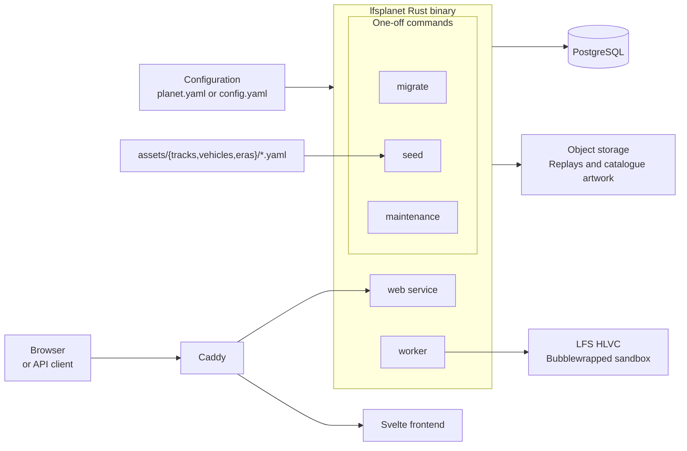

# Architecture

lfspla.net is a Rust API and worker using PostgreSQL, with a Svelte frontend.



## Application code

Each database concept has a singular module in `src/models`. Modules with
submodules use a directory with `mod.rs`, such as `player/mod.rs`,
`hotlap/mod.rs`, `era/mod.rs`, and `ranking/mod.rs`. The entry file defines the
SeaORM row, relations, reusable scopes, and basic operations. Larger
implementations live alongside it, such as `player/profile.rs` and
`ranking/standings.rs`. Standalone leaf modules use a single `.rs` file.

Application callers use named records exported from `models`, for example
`Player::find_by_username`, `Era::find_by_slug`, and `Hotlap::count_outstanding`.
SeaORM's `Entity`, `Column`, and `ActiveModel` remain available in the singular
model module when a caller needs to compose a query. Read models such as `HotlapPage` and `RankingWithCharts` own joined and
aggregated reads. `Hotlap::list` in `models/hotlap/list.rs` loads filtered,
ordered pages shared by the hotlap collection and chart leaderboard routes.
HTTP adapters resolve ownership and chart scope, and API conversion builds
public responses. Services own complete workflows rather than these reads.

`src/services` owns complete application workflows:

`manage_lfs/mod.rs` owns installation downloads and caching, installation and
update workflows, path resolution, and reviewed trimming. The LFS CLI owns
arguments, confirmation, and presentation. Validation shares the service's
installation resolver. `src/lfs` retains API client construction and the shared
installation identifier validation used by era definitions.

`repair_eras/mod.rs` owns stored-version reclassification and its transactional
personal-best rebuild, followed by badge refreshes. `storage_gc/mod.rs` owns
object retention checks and deletion, with progress supplied to the caller and
summaries returned for presentation. Player restriction updates belong to
`Player` methods.

CLI command groups keep their argument definitions beside dispatch in `mod.rs`.
`cli::run` owns top-level dispatch; `main.rs` configures logging and parses the
arguments. Small LFS command adapters live directly in `cli/lfs/mod.rs`, while
trim confirmation and output remain in `cli/lfs/trim.rs`.

| Service                | Responsibility                                                                             |
| ---------------------- | ------------------------------------------------------------------------------------------ |
| `submit_hotlap`        | Parse a replay, resolve its vehicle, store its bytes, and admit the submission             |
| `validate_hotlap`      | Run LFS validation, publish the result, update personal bests, and queue notifications     |
| `catalogue::seed`      | Apply local definitions and artwork under one transaction and rebuild affected projections |
| `catalogue::eras`      | Persist era policy and manage era lifecycle changes                                        |
| `deliver_webhook`      | Send queued notifications and record delivery, cooldown, and retry outcomes                |
| `catalogue::sync_mods` | Synchronise upstream Vehicle Mod metadata and covers                                       |

The validation and delivery services implement `lfsplanet_jobs::Processor`
directly. `cli/worker.rs` constructs and registers them with the generic runner;
there is no separate application jobs layer.

HTTP handlers own request parsing, authentication, and response formatting.
CLI commands own operator confirmation and terminal output. `catalogue::load`
owns tagged YAML input and retains each definition’s source path. Both
call services and model operations. Services and models do not depend on these
entrypoints.

Each catalogue definition applies its own data within the batch transaction;
locations also apply their nested tracks and report those changes together. Track
and vehicle definitions persist their own canonical metadata and optional artwork.
The batch owns era review, projection rebuilds, and commit. Imports without era
documents skip era definition queries and review preparation.

`src/db` owns connection setup, migrations, shared advisory locks, SQL binding
helpers, and checked PostgreSQL value conversions. Feature SQL stays with its
model. `personal_best` owns both incremental updates and bulk rebuilds;
`badge/refresh.rs` owns award calculation and refresh retries.

Transaction boundaries belong to the operation coordinating the changes.
Publication updates, personal bests, and notification snapshots commit together.
Catalogue changes retain their exclusive lock through projection rebuilding.
External LFS runtime operations use the standalone `lfsplanet_lfs` crate and its
platform-selected implementation.

## Catalogue

The YAML files in `assets/tracks/`, `assets/vehicles/`, and `assets/eras/` are
setup files. Apply them explicitly:

```sh
lfsplanet maintenance sync-mods
lfsplanet seed assets/tracks/*.yaml assets/vehicles/*.yaml assets/eras/*.yaml
```

`sync-mods` refreshes Vehicle Mods. `seed` applies location definitions with nested tracks, vehicle artwork, and era
definitions in one transaction. New eras need no confirmation; changes need `--yes`. Startup
does not apply these files. See [catalogue seeding](catalogue.md) for document
formats and artwork handling.

## HLVC worker

Uploads are parsed, queued, and matched to an open era. Run the worker
separately:

```sh
lfsplanet worker
```

The worker validates queued hotlaps with the era's LFS installation, Wine, and
Bubblewrap. It publishes valid laps and records all other results. See [replay
validation](validator.md) for host requirements.
