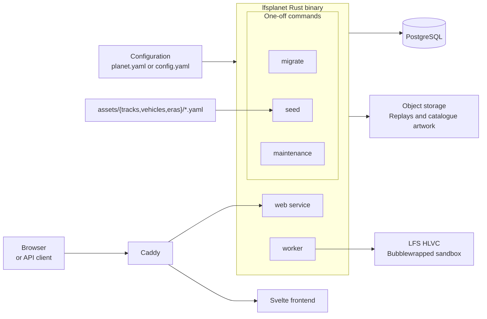

# Architecture

lfspla.net is a Rust API and worker using PostgreSQL, with a Svelte frontend.



## Application code

The binary owns HTTP and CLI adapters, logging, application configuration loading,
and dependency construction. It also owns the records only the web application
uses: personal access tokens (`src/personal_access_token.rs`) and homepage community
cards (`src/community_card/`).
Application records and workflows live in workspace libraries:

| Crate                     | Ownership                                                                                                                                                                                                                               |
| ------------------------- | --------------------------------------------------------------------------------------------------------------------------------------------------------------------------------------------------------------------------------------- |
| `lfsplanet_core`          | Shared players, teams, tracks, vehicles, attachments, badge definitions and awards, database connections and migrations, object storage, and shared configuration types                                                                 |
| `lfsplanet_hotlaps`       | Hotlaps, eras, charts, rankings, badge qualification and refreshes, player hotlap read models, catalogue application, replay submission and validation, game versions, player flags, LFS installation identifiers, and webhook delivery |
| `lfsplanet_race_calendar` | LFS leagues, seasons, and event advertisements, and their synchronisation from public league pages                                                                                                                                      |
| `lfsplanet_jobs`          | The existing concurrent record-processor runner                                                                                                                                                                                         |

`lfsplanet_hotlaps` and `lfsplanet_race_calendar` each depend on `lfsplanet_core`;
the core crate depends on neither, and the two feature crates do not depend on
each other. Shared entities omit feature-owned reverse relation
fields. The hotlaps crate implements SeaORM's `Related` trait for those relations
in `src/relations.rs`. Player hotlap activity, profile, and comparison operations
are feature-owned traits implemented for the shared player record.

Code names each item by its owning crate. Libraries do not re-export another
crate's modules, so a shared record is always `lfsplanet_core::models::…` and a
hotlap record is always `lfsplanet_hotlaps::models::…` (`crate::models::…` inside
hotlaps).

Settings live with their owners, and each YAML section matches its crate: core
exports database, storage and common value types; `lfsplanet_lfs_net_api` exports
its client configuration (`lfs_net`);
hotlaps exports upload policy, installation root, platform runtime, validation and
webhook worker settings (`hotlaps`). The binary composes them with web settings in
`src/settings` and coordinates validation and path resolution.

Each database concept has a singular module in its owning crate's `src/models`. Modules with
submodules use a directory with `mod.rs`, such as `player/mod.rs`,
`hotlap/mod.rs`, `era/mod.rs`, and `ranking/mod.rs`. The entry file defines the
SeaORM row, relations, reusable scopes, and basic operations. Larger
implementations live alongside it, such as `player/profile.rs` and
`ranking/standings.rs`. Standalone leaf modules use a single `.rs` file.

Application callers use named records exported from `models`, for example
`Player::find_by_username`, `Era::find_by_slug`, and `Hotlap::count_outstanding`.
SeaORM's `Entity`, `Column`, and `ActiveModel` remain available in the singular
model module when a caller needs to compose a query. Read models such as `HotlapPage` and `RankingWithCharts` own joined and
aggregated reads. `Hotlap::list` in `models/hotlap/list.rs` loads filtered,
ordered pages shared by the hotlap collection and chart leaderboard routes.
HTTP adapters resolve ownership and chart scope, and API conversion builds
public responses. Services own complete workflows rather than these reads.

The era combinations listing includes `participants`, counting drivers with a
current valid personal best on each chart. `column=participants&order=desc`
provides the era overview's "Most hotlapped combos" tab. PostgreSQL counts using
the existing personal-best chart indexes and sorts before pagination; repeated
uploads do not inflate the counts. Catalogue sorts retain their existing default
order and only count participants for the returned page.

Each library's `src/services` owns complete application workflows:

`manage_lfs/mod.rs` owns installation downloads and caching, installation and
update workflows, path resolution, and reviewed trimming. The
`hotlaps installation` CLI owns arguments, confirmation, and presentation.
Validation shares the service's installation resolver. `lfsplanet_lfs_net_api::Config`
constructs the LFS API client; hotlaps owns the installation identifier validation
used by era definitions.

`repair_eras/mod.rs` owns stored-version reclassification and its transactional
personal-best rebuild, followed by badge refreshes. `storage_gc/mod.rs` owns
object retention checks and deletion, with progress supplied to the caller and
summaries returned for presentation. Player restriction updates belong to
`Player` methods.

CLI commands are grouped by the resource they act on, not by the crate that
implements them. Processes and setup (`web`, `worker`, `migrate`, `seed`,
`generate-config`, `openapi`, `demo`) and garbage collection (`gc`) belong to the
binary; `players`, `badges`, `track-locations` (`cli/track_locations.rs`) and `vehicles` (`cli/vehicles.rs`)
act on catalogue and account records; `hotlaps` (`cli/hotlaps/`, including its
`era` and `installation` groups) and `race-calendar` (`cli/race_calendar.rs`)
front their feature areas. The daily maintenance timer runs `gc --all --yes`,
`hotlaps rebadge --pending`, `race-calendar sync` and `vehicles sync-mods` as
separate steps.

Command groups keep their argument definitions beside dispatch in `mod.rs`.
`cli::run` owns top-level dispatch; `main.rs` configures logging and parses the
arguments. Small installation command adapters live directly in
`cli/hotlaps/installation/mod.rs`, while trim confirmation and output remain in
`cli/hotlaps/installation/trim.rs`.

| Service                | Responsibility                                                                             |
| ---------------------- | ------------------------------------------------------------------------------------------ |
| `submit_hotlap`        | Parse a replay, resolve its vehicle, store its bytes, and admit the submission             |
| `validate_hotlap`      | Run LFS validation, publish the result, update personal bests, and queue notifications     |
| `catalogue::seed`      | Apply local definitions and artwork under one transaction and rebuild affected projections |
| `catalogue::eras`      | Persist era policy and manage era lifecycle changes                                        |
| `deliver_webhook`      | Send queued notifications and record delivery, cooldown, and retry outcomes                |
| `catalogue::sync_mods` | Synchronise upstream Vehicle Mod metadata and covers                                       |
| `sync_events`          | Fetch public LFS schedules and synchronise event advertisements                            |

`crates/lfsplanet_lfs_net_leagues` owns public league page fetching, parsing,
calendar reconciliation, source types and validated logo downloads. Its snapshot
function accepts the current time and any known league IDs from the caller;
it has no database or object storage dependency. `lfsplanet_race_calendar` owns
import locking, persistence, dry runs and logo caching.

`race-calendar sync` imports complete league snapshots in short transactions;
`--dry-run` compares changes and rolls them back. `--source-only` previews upcoming
source records without a database. The public events API and `/events` page read
the stored advertisements. Event imports also run as a step of the daily
deployment maintenance timer.

The validation and delivery services implement `lfsplanet_jobs::Processor`
directly. `cli/worker.rs` constructs and registers them with the generic runner;
there is no separate application jobs layer.

HTTP handlers own request parsing, authentication, and response formatting.
CLI commands own operator confirmation and terminal output. `catalogue::load`
owns tagged YAML input and retains each definition’s source path. Both
call services and model operations. Services and models do not depend on these
entrypoints.

Each catalogue definition applies its own data within the batch transaction;
locations also apply their nested tracks and report those changes together. Track
and vehicle definitions persist their own canonical metadata and optional artwork.
The batch owns era review, projection rebuilds, and commit. Imports without era
documents skip era definition queries and review preparation.

`lfsplanet_core::db` owns connection setup, migrations, shared advisory locks, SQL binding
helpers, and checked PostgreSQL value conversions. Feature SQL stays with its
model. `personal_best` owns both incremental updates and bulk rebuilds;
`badge/refresh.rs` owns award calculation and refresh retries.

Transaction boundaries belong to the operation coordinating the changes.
Publication updates, personal bests, and notification snapshots commit together.
Catalogue changes retain their exclusive lock through projection rebuilding.
Local LFS installation and validation use the standalone `lfsplanet_lfs_installations` crate and its
platform-selected implementation.

Migration SQL remains in the workspace's `migrations/` directory with its existing
identifiers and checksums. The database library embeds it and the binary retains
the single `migrate` command. Every database test runs against that one migrator,
`#[sqlx::test(migrator = "lfsplanet_core::db::MIGRATOR")]`; crates do not keep
their own `migrations` or `assets` directories. Tests that exercise shared records
with hotlap data, such as attachment garbage collection and vehicle mod authors,
live in hotlaps' `src/tests` rather than introducing a core-to-hotlaps dependency.
The hotlaps library's `test-support` feature exposes `test_support::FIXTURE_SQL`,
`LEGACY_FIXTURE_SQL`, the workspace `assets_dir()`, and the catalogue fixture
helpers to the binary's tests. The SQL fixtures live in
`crates/lfsplanet_hotlaps/fixtures/`.

## Catalogue

The YAML files in `assets/tracks/`, `assets/vehicles/`, `assets/eras/`, and `assets/community/` are
setup files. Apply them explicitly:

```sh
lfsplanet vehicles sync-mods
lfsplanet seed assets/tracks/*.yaml assets/vehicles/*.yaml assets/eras/*.yaml assets/community/*.yaml
```

`vehicles sync-mods` refreshes Vehicle Mods. `seed` applies location definitions with nested tracks, vehicle artwork, era
definitions and community cards in one transaction. The command routes `CommunityCard`
documents to the binary's card applier and every other kind to the hotlaps catalogue;
both run inside one transaction under the catalogue write lock through
`catalogue::seed_in`, and badge rebuilds follow the commit. New eras need no confirmation; changes need `--yes`. Startup
does not apply these files. See [catalogue seeding](catalogue.md) for document
formats and artwork handling.

## HLVC worker

Uploads are parsed, queued, and matched to an open era. Run the worker
separately:

```sh
lfsplanet worker
```

The worker validates queued hotlaps with the era's LFS installation, Wine, and
Bubblewrap. It publishes valid laps and records all other results. See [replay
validation](validator.md) for host requirements.
