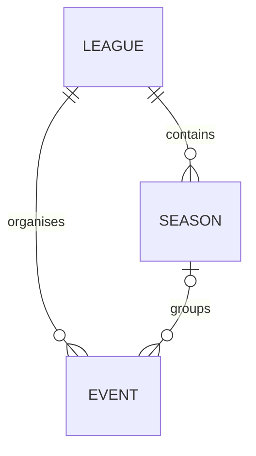

# Community events

lfspla.net advertises community events imported from the public LFS league pages.
The `/events` page shows upcoming meetings with local start times, league and
season filters, optional league logos and car/track labels, and links for details or joining.
Individual practice, qualifying and race sessions are not stored.

## Importing

Apply the schema migration before using the importer or API:

```sh
lfsplanet migrate
lfsplanet maintenance sync-events --dry-run
lfsplanet maintenance sync-events
```

| Mode                        | Behaviour                                                                                |
| --------------------------- | ---------------------------------------------------------------------------------------- |
| `sync-events`               | Fetch source schedules and commit successful league imports.                             |
| `sync-events --dry-run`     | Compare with the database and roll back all proposed changes.                            |
| `sync-events --source-only` | Print upcoming source records without loading configuration or connecting to a database. |

All modes accept `--league 432` to inspect one upstream league. Otherwise they
scan the active directory, leagues found in the current calendar, and (in database
modes) known imported leagues with future events. Public pages need no LFS OAuth
credentials. Database modes use the normal `--config` settings.

Import reports contain local IDs, parent-qualified external IDs, and a `change`
value of `created`, `updated`, or `unchanged` for each record. Dry-run IDs for new
records are provisional. Dry runs use real transactions and roll them back;
PostgreSQL identity sequences can advance, as with catalogue seed dry runs.
`--source-only` prints source records instead of a database comparison.

Reports include failures and stale future event IDs. A partial import exits
unsuccessfully even if other leagues were saved. Missing records are retained;
disappearance is not treated as cancellation. Inspect `failures` and
`stale_events` before hiding a listing manually. Repeated imports never reset an
event's local `hidden` flag.

## Stored records



Every event belongs to a league and optionally a season. A composite foreign key
ensures its season belongs to the same league. Local IDs are independent of
upstream IDs; local records use `source = local` and need no external identity.

- `league`: name, optional description/website/forum links, image attachment and timestamps.
- `season`: league, name, optional description and timestamps.
- `event`: league, optional season, title, description, UTC meeting start,
  details/signup links, optional car/track labels, local visibility and timestamps.
  Each table stores its provenance directly: `source`, `external_id`, `source_url`,
  `last_seen_at` and `last_synced_at`. `source` is a shared Rust enum (`Local` or
  `LfsNet`), backed by an ordinary PostgreSQL `TEXT` column with allowed-value
  checks. New rows default to `local`, with null external metadata. Imported rows
  use `lfs_net` and require a nonempty external ID.

Each table enforces uniqueness on `(source, external_id)`; multiple local rows
can have null external IDs. LFS uses parent-qualified keys such as `432`,
`432/1347`, and `432/1347/6696`. Importing does not merge records by title or
start time. The inline-source migration copies the former mapping tables into
these columns and removes those tables, preserving record IDs, timestamps,
relationships and league images.

The source currently supplies league/season names and event advertisements.
Additional optional league/season metadata is reserved for later authoring or
richer imports. New imported leagues have no owners. A future league membership
relation can grant owners/editors access to their seasons and events; claiming a
league requires verification and an explicit editing/import-override policy.

## Source workflow

`src/services/sync_events/` coordinates fetching, validation, comparison and
transaction boundaries. `lfs_net/parse.rs` contains pure HTML parsers backed by
captured regression fixtures. Models own persistence and reusable reads.

1. Fetch the current week's calendar and the active league directory at
   [lfs.net/leagues](https://www.lfs.net/leagues).
2. Follow each league's current/active season links. Season pages contain round
   schedules directly, avoiding a request for every round. Known leagues with
   future events are revisited even after leaving the active directory.
3. Map each round to one event. Use the calendar's advertised start when present,
   otherwise the earliest scheduled session. Read explicit UTC `datetime`
   attributes instead of relative display text. Session rows are parsing inputs,
   not persisted records. Car/track labels are included only when consistent
   throughout the round; unspecified or mixed combinations can be omitted.
4. Retain the complete schedules of active seasons when persisting. This lets a
   previously advertised meeting be corrected even when its start moves into the
   past. The source-only preview and default public list show upcoming events.
5. Apply each complete league snapshot in a short transaction. Fetching happens
   outside those transactions. A failed required league/season page leaves that
   league's previous records intact; other leagues can still succeed. A calendar
   or directory failure stops the run before persistence.
6. Report future calendar rounds missing from active schedules as league
   failures. Completed calendar rounds can outlive active seasons and do not
   cause these failures. Stored future listings missing from a successful
   snapshot are reported as stale without being deleted or hidden.

A session advisory lock prevents overlapping database syncs before fetching. A
separate, dedicated connection holds the lock and closes on exit or cancellation;
pooled connections never retain it. Imports need a direct PostgreSQL connection
or session pooling, rather than transaction pooling.

Requests run sequentially with a 500 ms pause, 15 second timeout, 2 MiB response
limit and 128 request budget. The client identifies itself. Redirects stay on the
LFS origin and expected league paths. External participation links are validated
HTTP(S) URLs and are not crawled. Unexpectedly empty directories, missing tables,
invalid dates and parent mismatches fail explicitly.

The current calendar cross-check covers one week. An eight-week calendar window,
round-detail fallback, owner management and local authoring are not yet
implemented. These parsers follow observed markup, not a supported upstream API.
A supported feed can replace source parsing while retaining local identities.

## League logos

The scraper extracts the dedicated `img.leagueLogo` from a league page. It does
not import images embedded in league news or descriptions. Source-only previews
include the upstream `logo_url` without downloading image bytes.

Database imports download logos for successfully imported leagues and cache them
as attachments, linked through `league.image_attachment_id`. The image stage
runs after metadata transactions, with separate short transactions for attachment
references. PNG, JPEG, GIF and WebP are accepted with matching content types and
file signatures. Downloads and redirects are restricted to the LFS
`/dynamic/leaguelogos/` directory and use the same timeout, byte limits and request
spacing as page fetching, with a separate 128-request budget.

Identical bytes reuse the league's existing attachment and public URL. Changed
images replace its reference; obsolete attachments follow normal storage garbage
collection. Missing logos, download errors and storage failures preserve cached
logos. Image problems appear in the report's `warnings` without failing otherwise
successful event imports. `images_updated` reports changed logos (proposed
changes during dry runs).

Dry runs fetch and compare images but never upload bytes or persist attachment
references. The events API returns an optional `league.image` attachment, and the
events page displays it in the image panel on the left. Leagues without a logo use the
same listing layout with the standard image placeholder.

## Public API and page

`GET /api/v1/events` returns the standard paginated envelope, ordered by UTC start
and local ID. Hidden events are always excluded. Supported query parameters:

| Parameter                | Behaviour                                                        |
| ------------------------ | ---------------------------------------------------------------- |
| `league_id`, `season_id` | Positive local IDs; combine filters when both are supplied.      |
| `starts_from`            | Inclusive RFC 3339 timestamp, defaults to the current instant.   |
| `starts_before`          | Optional exclusive RFC 3339 timestamp, later than `starts_from`. |
| `page`, `per_page`       | Standard one-based pagination, at most 100 items per page.       |

Items include local identity, league/optional season summaries, title, optional
description, RFC 3339 start, and optional details/signup/car/track fields. Source
IDs and moderation controls remain internal. Counts and page data share one
read-only database snapshot.

The `/events` page loads 25 upcoming meetings per page through the generated SDK.
Each card shows its league logo on the left and a combined
`League / Season / Event` title. The whole card links to event details, with hover
and keyboard focus styling. Cards without a details URL remain non-clickable. Seasons are omitted from
the title when absent. Start time, track and cars appear below the title. Times
use the visitor's local time zone and the page identifies that zone. Descriptions
render as text. The page has no separate details or participation buttons.

## Homepage events

Below the two carousels, Activity and a compact **Racing this week** section
share a two-thirds/one-third layout on wide screens (1280px and above), and stack
on smaller screens. The events sidebar uses the era page’s divider treatment:
a left border on wide screens and a top border when stacked. Activity uses the
full width when there are no events.
The events section shows all visible meetings starting within the next seven
days, ordered by start time. The window is `[now, now + 168 hours)`, calculated
once per page load. The existing events API filters this window on the server;
the homepage fetches every matching page, with up to 100 events per request.
It supplies these records directly;
there are no generated community card rows or catalogue seeds.

Each row shows a small league logo, combined league/season/event title, and local
start time, using the shared date/time component. The whole row links
to event details, falling back to `/events` when no details URL exists. A
**All events** link below the list leads to the full listing. Empty weeks hide the
section. Failed event loads show the shared `Empty` component with an unavailable
message, without affecting other homepage content.

Community & partners contains authored cards only. That carousel and Community
spotlights still shuffle independently on every page load, with no browser queue,
storage or recent-history tracking. Each order stays stable while its carousel
runs.

## Scheduled operation

Deployment installs and enables `lfsplanet-events.timer`, which runs
`maintenance sync-events` hourly with up to five minutes of jitter. It is a
separate unit from daily maintenance. Deployment stops both the timer and any
running event import before replacing the binary or migrating the schema, then
reenables the timer afterwards. No event sync is added to `maintenance run-all`.

After deploying, inspect or trigger a refresh with:

```sh
systemctl start lfsplanet-events.service
systemctl status lfsplanet-events.timer lfsplanet-events.service
journalctl -u lfsplanet-events.service
```

The service has a 40 minute start timeout. Fetch/parse failures produce a failing
service result and an import report in the journal while preserving stored data.
